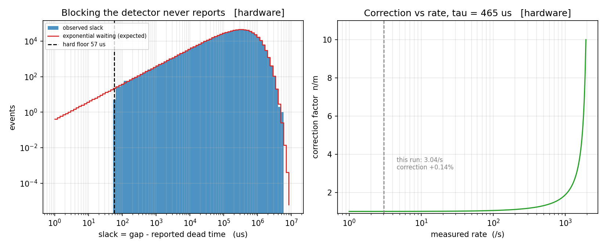

# Coincidence-gated particle counter with dead-time correction

A two-channel particle counter that reports a rate it can actually defend:
FPGA coincidence logic, plus dead-time and accidental-coincidence correction
that is **measured, not assumed**.

> **Status:** simulation and FPGA synthesis are complete and verified.
> No hardware has been built. Every figure is labelled `[simulated]` or
> `[hardware]`, and the label is never dropped.

## Headline result — found unreported dead time in a real detector

The estimators were run over **62.8 hours of public cosmic-ray muon data
(687,941 events)** from a CosmicWatch Desktop Muon Detector v3X.

No event ever arrives sooner than **57 µs** after the detector's own booked
dead time ends. For random (exponential) arrivals the expected floor is about
**0.48 µs**. The probability of that gap arising by chance is of order
**10⁻⁵²**. The instrument blocks roughly **14% longer than it reports** —
found from event timestamps alone, which the instrument's own accounting
missed.



## What else is in here

| Stage | Result | Status |
|---|---|---|
| 0 | Simulator reproduces textbook dead-time curves (1.69σ) | pass |
| 1 | Four independent τ estimators agree within 6% of hidden τ | pass |
| 1 | **Lambert-W degeneracy:** under paralyzable dead time one measured rate maps to two true rates 14× apart (1637/s → 2,000/s *or* 28,604/s); resolved by rate perturbation, since sign(dm/dn) = sign(1 − nτ) | pass |
| 2a | Accidental coincidences follow 2τR₁R₂ (1.50σ over a 50× window sweep) | pass |
| 2b | Verilog RTL matches the Python reference model exactly at every window | pass |
| 3 | Synthesised with Yosys + nextpnr — see below | pass |
| 4 | Validated on real data we did not generate | pass |
| 5–6 | Write-up and archival DOI | not started |

### Synthesis (committed reports in `synth/`)

| Target | Utilisation | Fmax across 6 placement seeds | Time resolution |
|---|---|---|---|
| iCE40-UP5K | 10% | 40–43 MHz | 23.9 ns |
| iCE40-HX8K | 7% (301 LUT, 370 FF) | 93–102 MHz | 10.2 ns |

At 100 MHz on HX8K timing closes on 2 of 6 seeds. The full spread is reported,
not the best run.

## Known limits

- No hardware. Simulation cannot discover what was not modelled.
- The 100 MHz target on HX8K is marginal.
- Stages 5 and 6 are not done.

## Layout

```
rtl/         Verilog coincidence and counting logic
sim/         Python dead-time models, Poisson generator, estimators
tb/          testbenches
synth/       Yosys / nextpnr scripts and committed reports
validation/  real CosmicWatch data and the validation pipeline
figures/     every figure, regenerable from committed inputs
SPEC.md      every decision taken, and why
```

Tools are all free and open source: Icarus Verilog, Yosys, nextpnr,
GTKWave, NumPy, SciPy, Matplotlib. Data attribution is in
[ATTRIBUTION.md](ATTRIBUTION.md).
